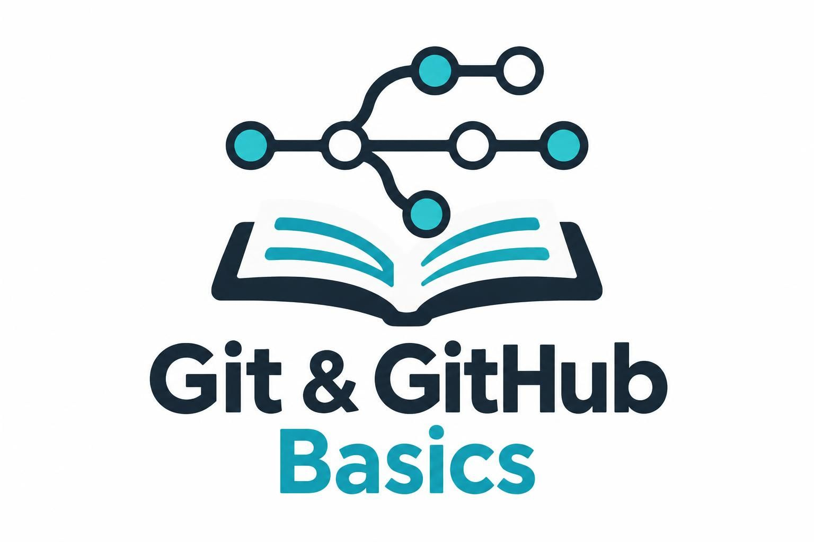

This website contains a basic introduction to Git and GitHub. Its aim is to equip absolute beginners with the tools to track code versions in a local repository and interact with remote repositories on GitHub &mdash; either alone or in the simple case of collaborating with others from forks. 

> [!NOTE]
> As mentioned above, the target audience for this website are absolute beginners. Therefore, the website covers only very basic concepts and use cases. This is intentional and should not be seen as a limitation.

The material in this website was written by a neuroscience researcher for students of a neuroscience master's. Therefore, some of the examples provided throughout the website come from neuroscience. However, all concepts apply seamlessly to any other domain. 

